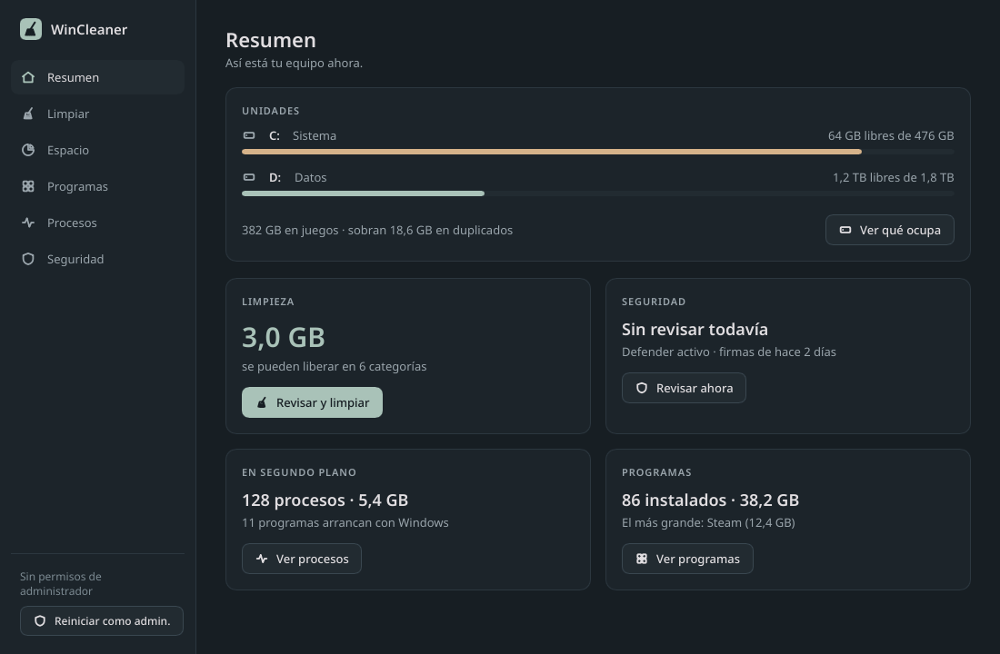

<div align="center">

# 🧹 WinCleaner

**Limpieza y puesta a punto de Windows, sin complicaciones.**


</div>

---

## ✨ Qué es

WinCleaner es una herramienta para dejar Windows limpio y ligero: muestra dónde se va el espacio del disco, libera el que ocupan los archivos temporales y las cachés, y te deja ver y ordenar lo que tienes instalado, en marcha y arrancando con Windows. Es un único `.exe` portable de unos 8,2 MB (8 218 624 B; el límite es 8 MiB), sin instalación, sin telemetría y con la interfaz en español. Funciona en Windows 10 1809 o posterior y en Windows 11.



> 🚧 **Estado.** La v2 está compilada desde Linux y pendiente de su primera prueba en un Windows real. La captura es un render por software hecho en Linux, con otra fuente.

## 🔍 Funciones

La v2 tiene seis secciones en una barra lateral (con solo iconos por debajo de 1000 px de ancho). Pulsa la marca para ver «Acerca de».

**Resumen.** Espacio libre de cada unidad y un vistazo a lo demás: lo que se puede liberar, procesos, programas y seguridad.

**Programas.** Lista de lo instalado, con icono, tamaño y fecha, con búsqueda y orden. «Desinstalar» pide confirmación y ejecuta el desinstalador del propio programa; WinCleaner espera a que termine y refresca la lista.

**Procesos.** Procesos agrupados con CPU y memoria, y la lista de programas de arranque (carpetas de inicio, claves `Run`), que se pueden activar o desactivar sin borrar nada. Se puede terminar un proceso con confirmación.

**Seguridad.** Estado de Microsoft Defender (activo, edad de las firmas), análisis rápido o completo que se puede cancelar, detecciones recientes y comprobaciones propias de solo lectura: programas de arranque, procesos, servicios y tareas programadas de inicio en sitios raros o sin firma, procesos de sistema falsos, archivo `hosts` y proxy. Cada hallazgo explica por qué importa y, según el caso, permite desactivar el inicio, terminar el proceso, abrir su ubicación o buscar su nombre en internet. Si una comprobación no se ha podido hacer, se dice.

**Analizar.** Elige una unidad y WinCleaner lista las 50 carpetas y los 50 archivos más grandes, con un botón para abrir su ubicación en el Explorador. Se puede detener. Las carpetas se muestran sin repetir la cadena de antecesoras, para que se vea dónde se concentra el espacio.

**Limpiar.** Nueve categorías, cada una con su casilla y su tamaño (bytes y archivos) antes de borrar:

| Categoría | Qué se limpia | Antigüedad | Admin |
|---|---|---|---|
| Temporales del usuario | `%TEMP%` | sin modificar en más de 24 h | no |
| Temporales de Windows | `%SystemRoot%\Temp` | sin modificar en más de 24 h | sí |
| Papelera de reciclaje | Todas las unidades, con la API del sistema | se vacía entera | no |
| Caché de miniaturas | `thumbcache_*.db` en `%LOCALAPPDATA%\Microsoft\Windows\Explorer` | todos | no |
| Caché de Chrome | `Cache`, `Code Cache` y `GPUCache` de cada perfil (`Default`, `Profile N`) en `%LOCALAPPDATA%\Google\Chrome\User Data` | todo | no |
| Caché de Edge | Lo mismo, en `%LOCALAPPDATA%\Microsoft\Edge\User Data` | todo | no |
| Caché de Firefox | `cache2` de cada perfil en `%LOCALAPPDATA%\Mozilla\Firefox\Profiles` | todo | no |
| Volcados de errores y logs antiguos | `%LOCALAPPDATA%\CrashDumps` y `%LOCALAPPDATA%\Microsoft\Windows\WER\{ReportArchive,ReportQueue}`. Con administrador, también `%ProgramData%\Microsoft\Windows\WER\{ReportArchive,ReportQueue}`, `%SystemRoot%\Minidump` y `%SystemRoot%\Logs\CBS` | sin modificar en más de 30 días | no (las rutas de sistema, sí) |
| Caché de Windows Update | `%SystemRoot%\SoftwareDistribution\Download` | todo | sí |

Solo se borra el contenido de esas carpetas, nunca la carpeta raíz. Las cookies, el historial y las contraseñas de los navegadores no se tocan porque no están en ninguna de esas rutas. Si una carpeta no existe, la categoría sale como «no encontrado» y queda desactivada.

## 🛡️ Seguridad

- **Lista blanca.** Un archivo solo se borra si su ruta está estrictamente dentro de una de las carpetas de la tabla. No se aceptan `..`, rutas relativas, `\\?\`, rutas de red ni flujos alternativos.
- **Carpetas protegidas.** Nunca se limpia una carpeta igual o antecesora de la raíz de una unidad, tu perfil, `Windows`, `System32` o `Program Files`. Documentos, Escritorio, Descargas, Imágenes, Música y Vídeos (con su ruta real, aunque estén en OneDrive) quedan vetadas por completo: ni ellas, ni sus antecesoras, ni nada de lo que contienen. Si `%TEMP%` apunta a un sitio raro, esa categoría sale como «ruta no reconocida». Si Windows no puede indicar cuáles son las carpetas protegidas, la app se niega a limpiar nada salvo la papelera.
- **Enlaces.** Los enlaces simbólicos y los junctions no se siguen ni se borran. Cada borrado se hace por handle: se abre el archivo sin seguir enlaces, se comprueba su ruta real dentro de la carpeta y se borra ese mismo objeto, así que cambiar a mitad una carpeta intermedia por un junction no sirve para borrar nada de fuera.
- **Archivos en uso.** Los bloqueados o sin permiso se saltan sin errores y se cuentan en el informe.
- **Confirmación.** Borrar, terminar un proceso y desinstalar pasan siempre por un modal que lista lo que va a pasar. El foco empieza en «Cancelar» y Intro y Esc siempre cancelan: solo se confirma con un clic o con Espacio sobre el botón de confirmar. Mientras se limpia, la ventana no se puede cerrar ni se cambia de sección.
- **Desinstalar.** Solo se lanza el desinstalador `.exe` del propio programa (o `msiexec /x {GUID}` con un GUID válido), siempre por ruta absoluta. Nunca se ejecuta otra cosa ni se pasa por el `PATH`.
- **Procesos.** No se pueden terminar los procesos críticos ni los que están en la carpeta de Windows, ni WinCleaner, ni los de otro usuario (solo los de tu sesión). Antes de terminar uno se vuelve a comprobar que el PID sigue siendo el mismo programa.
- **Arranque.** Activar o desactivar un programa de inicio es reversible: solo cambia su valor en `StartupApproved`, igual que el Administrador de tareas, y no borra nada.
- **Comprobaciones de seguridad.** Solo leen. WinCleaner **no es un antivirus**: usa Microsoft Defender y avisa de cosas raras, nada más. No se conecta a la red: las firmas se comprueban sin consultar servidores, y «Buscar en internet» abre tu navegador solo con el nombre del archivo, nunca con la ruta.
- **Informe.** Al terminar, lo liberado por categoría y los archivos saltados.

## 🚀 Uso

1. Descarga `wincleaner.exe` de [Releases](https://github.com/9n-dev/wincleaner/releases) (o [compílalo](#-compilar)). Puedes comprobarlo con la SHA-256 que va al lado: en PowerShell, `Get-FileHash .\wincleaner.exe`.
2. Ejecuta `wincleaner.exe`, sin instalar nada. Arranca sin permisos de administrador. Como el `.exe` no está firmado, SmartScreen puede avisar de que es una aplicación desconocida («Más información» → «Ejecutar de todas formas»).
3. Las categorías que lo necesitan (Temporales de Windows y Windows Update) salen desactivadas. Pulsa «Reiniciar como administrador» para activarlas.

Notas:

- La papelera empieza desmarcada: es la única categoría con documentos que se pueden recuperar. Si la marcas, se vacía entera, también lo que se haya enviado a la papelera después de calcular los tamaños.
- Si elevas con las credenciales de otra cuenta, se limpian el perfil y la papelera de esa cuenta, no los tuyos.
- Explorer suele tener bloqueados los archivos de miniaturas, así que esa categoría puede liberar poco o nada. No es un fallo.
- Con el navegador abierto, sus archivos en uso se saltan.

## 🔨 Compilar

En Linux (compilación cruzada), necesitas `rustup target add x86_64-pc-windows-gnu` y mingw-w64 (`x86_64-w64-mingw32-gcc` y `windres`):

```sh
cargo test
cargo build --release --target x86_64-pc-windows-gnu
```

La interfaz es [Slint](https://slint.dev) 1.18.1 con renderizador por software. El proyecto vendoriza `i-slint-backend-winit` en `vendor/` (sin los decodificadores de imagen de Slint, para ahorrar ~700 KB), así que la interfaz no puede usar `@image-url`, PNG ni SVG; ver `vendor/i-slint-backend-winit/PARCHE.md`. Las pantallas se pueden dibujar en Linux con `cargo run --example capturas` (salen en `target/capturas/`).

El resultado queda en `target/x86_64-pc-windows-gnu/release/wincleaner.exe`.

En Windows necesitas Rust 1.92 o posterior (edición 2024) y el compilador de recursos que usa `embed-resource`: `rc.exe` del Windows SDK con la toolchain MSVC, o `windres` de mingw con la GNU. Después basta con `cargo build --release`.

## 🗺️ Hoja de ruta

- [x] v1: análisis del top 50 y limpieza de 9 categorías
- [x] v2: interfaz nueva con Slint y las secciones Resumen, Programas, Procesos y Seguridad
- [ ] Primera prueba en un Windows real

No están previstos: duplicados, registro, apps de Microsoft Store, limpiar restos de programas desinstalados, activar o desactivar servicios, limpiezas programadas, actualizaciones automáticas ni elegir carpetas a mano para borrar.

## 📄 Licencia

[MIT](LICENSE)

## 👤 Autor

Hecho por [@9n-dev](https://github.com/9n-dev).

Hecho con [Slint](https://slint.dev) (licencia Royalty-free 2.0).
